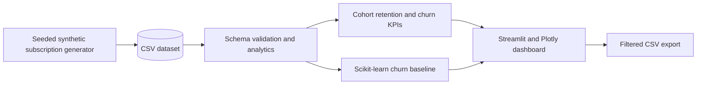

# SaaS Retention Analytics

**A local analytics workbench for subscription retention, signup cohorts, and explainable churn signals.** Explore a fictional SaaS customer dataset through an interactive dashboard, compare cohort retention curves, inspect customer segments, and train a logistic-regression baseline for churn risk.

> This project uses synthetic records for learning and portfolio demonstrations. It has not been deployed to AWS and requires no cloud account or cloud spend.


## What it demonstrates

- Reproducible synthetic data generation with configurable row count and random seed.
- Subscription features including plan, region, MRR, tenure, usage, feature adoption, support tickets, payment failures, and cancellation dates.
- SaaS KPIs, cohort retention, customer segmentation, and cancellation trends.
- A scikit-learn pipeline with numeric scaling, categorical encoding, and a stratified holdout evaluation.
- Churn risk bands, model coefficient direction, and filtered CSV export.
- A Streamlit and Plotly dashboard that runs entirely on your machine.

## Architecture



## Run locally

Requires Python 3.11 or newer.

### Windows PowerShell

```powershell
cd saas-retention-analytics
./run.ps1
```

### macOS or Linux

```bash
cd saas-retention-analytics
python3 -m venv .venv
source .venv/bin/activate
python -m pip install -r requirements.txt
streamlit run app.py
```

The dashboard opens at <http://localhost:8501>. Recreate the bundled fictional data with:

```bash
python -m src.generate_data --rows 2500 --seed 42 --output data/sample_subscriptions.csv
```

To explore another dataset, upload a CSV in the sidebar using the [documented schema](#data-schema).

## Data schema

| Column | Description |
|---|---|
| `customer_id` | Unique fictional customer ID |
| `signup_date`, `cancel_date` | Signup and optional cancellation date |
| `status` | `Active` or `Churned` |
| `plan`, `region` | Subscription tier and broad geography |
| `seats`, `monthly_revenue_usd` | Subscription size and monthly recurring revenue |
| `tenure_months` | Customer tenure in months |
| `weekly_active_days` | Product use on active days in a representative week |
| `feature_adoption_pct` | Fictional share of tracked capabilities adopted |
| `support_tickets_90d` | Recent support ticket count |
| `payment_failures_12m` | Payment failure count during the prior year |

## Metric notes

- **Active MRR:** sum of monthly revenue for records marked Active.
- **Sample churn rate:** churned records divided by all records. It is a dataset-level share, not a standard period churn rate.
- **Cohort retention:** for each signup month, the share of that cohort that has not cancelled by each observed month of tenure.
- **Model evaluation:** ROC-AUC, accuracy, precision, and recall on a fixed stratified holdout split.

Since the records and labels are synthetic, model metrics are not evidence of production performance. For real retention analysis, define the observation window, cancellation and reactivation rules, censored customers, and a leakage-safe prediction horizon before modeling.

## Project structure

```text
app.py                         Streamlit dashboard
src/analytics.py               Schema checks, cohorts, churn baseline
src/generate_data.py           Seeded fictional subscription generator
data/sample_subscriptions.csv  Bundled demo dataset
run.ps1                        Windows setup and startup helper
.github/workflows/ci.yml       Lint and syntax checks
```

## Contributing

Issues and pull requests are welcome. Suggested improvements include configurable observation dates, survival analysis, time-based holdout evaluation, and an optional AWS S3/Athena ingestion path. Keep example data synthetic and never commit customer data or credentials.

## License

MIT. See [LICENSE](LICENSE).

